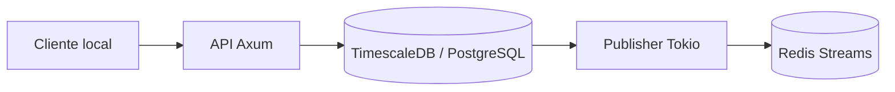
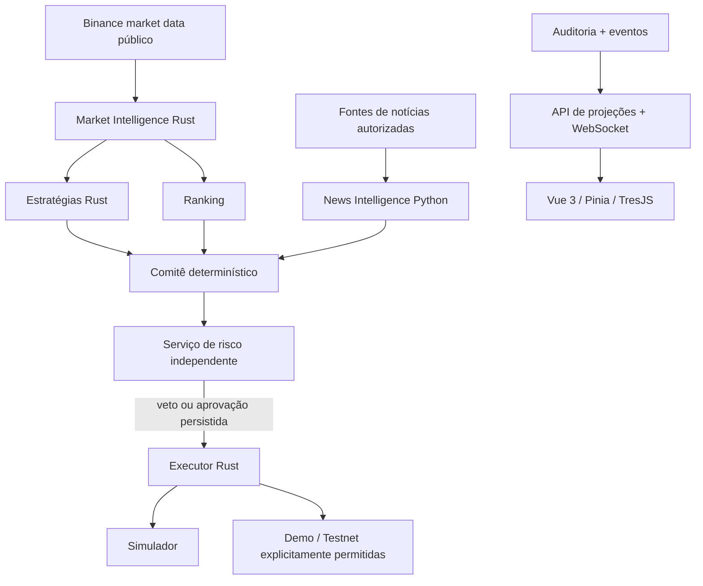

# Arquitetura

## Estado atual

Um workspace Cargo separa contratos e aplicação. A primeira entrega concentra
infraestrutura na API; domínio e adaptadores de trading serão separados antes de
introduzir decisões financeiras. O processo funciona sem navegador.

Uma transação grava `audit_events` e `event_outbox`. O publisher obtém lotes com
`FOR UPDATE SKIP LOCKED`, faz `XADD` e marca publicação. Se cair entre XADD e
commit, poderá republicar. Consumidores futuros usarão inbox com chave única de
evento e commit do efeito antes de `XACK`. Nenhuma promessa de exactly-once.
Não há trimming automático nesta etapa: retenção depende da política de replay
e do avanço dos consumidores. Auditoria permite replay mesmo após perda do Redis,
mas a ferramenta operacional de replay ainda não foi implementada.

Triggers impedem UPDATE, DELETE e TRUNCATE de auditoria. Isso protege contra
alterações acidentais, não contra administradores do banco. O usuário local tem
permissões de migration; separação de roles de migração/runtime e prova externa
de integridade são exigências para um ambiente compartilhado.

## Arquitetura alvo

O diagrama alvo não representa componentes já implementados. Cada agente visível
no escritório será registrado por um serviço real com heartbeat, estado,
versão e histórico. Serviço sem heartbeat deve aparecer indisponível, nunca
animado como se estivesse operando. O cliente só consulta projeções e envia
comandos operacionais autorizados; não executa estratégias.

## Invariantes financeiras para as próximas entregas

- Valores monetários e quantidades: decimal ou inteiros em unidades mínimas;
  serialização externa como strings decimais, sem conversão silenciosa para float.
- Um snapshot de mercado fechado, regra versionada e relógio injetável determinam
  a decisão. Registrar inputs, sinais, scores, justificativas e hashes das versões.
- Execução só aceita uma aprovação persistida de risco, de uso único e com prazo,
  vinculada ao hash exato da intenção. Reservas de saldo e exposição são atômicas
  por carteira; aprovações concorrentes não podem ultrapassar limites.
- O executor revalida validade, filtros, saldo reservado e identidade. A conexão
  de ordens existe apenas no executor. Python/LLMs jamais possuem essa capacidade.
- Idempotency key única por intenção; reconciliar timeout com exchange antes de
  reenviar. Timeout não significa ordem rejeitada. Fills alimentam ledger e posições.
- Limites, stop-loss e drawdown persistem entre reinícios. Dados atrasados, filtros
  ausentes ou risco indisponível bloqueiam novas ordens. Stop-loss simulado não
  promete execução ao preço indicado em gaps.
- Nenhum adaptador real em v1. Demo e testnet exigirão allowlist de hosts,
  credenciais separadas e teste de capacidades; indisponibilidade não permite
  fallback para produção. Consulta pública a preços de produção é separada de ordens.

## Dados, contratos e recuperação

Eventos v1 têm `event_id`, `correlation_id`, `occurred_at`, `producer`,
`schema_version` e payload discriminado. Nesta etapa há apenas `service_started`.
Mudanças incompatíveis exigem nova versão. Tipos TypeScript/schema compartilhado
serão introduzidos com o consumidor frontend, com teste de compatibilidade.

Candles são uma hypertable com chave `(symbol,timeframe,open_time)`, OHLC válido,
volume não negativo, fonte e horário de recebimento. Coleta futura deve distinguir
event time de ingestion time, persistir apenas candles fechados e reparar gaps.

Redis entrega eventos; PostgreSQL guarda o estado durável. Consumidores usarão
consumer groups, recuperação de pendências com XAUTOCLAIM, retry limitado e dead
letter com diagnóstico. WebSocket terá sequência e ressincronização por snapshot;
reconectar o navegador não deve reiniciar trabalho de agentes.

Backtests usarão dados disponíveis no instante simulado, decisão após fechamento
e fill no próximo instante negociável. Splits temporais e parâmetros congelados
separam treino, validação e teste. Registrar taxas, spread, slippage, benchmark,
exposição, drawdown e métricas ajustadas ao risco, com limitações explícitas.

## Referências técnicas consultadas

- [Axum: estado compartilhado e rotas](https://docs.rs/axum/0.8.6/axum/)
- [SQLx: migrations embutidas e rebuild](https://docs.rs/sqlx/0.8.6/sqlx/macro.migrate.html)
- [Compose: ordem de subida e health checks](https://docs.docker.com/compose/how-tos/startup-order/)
